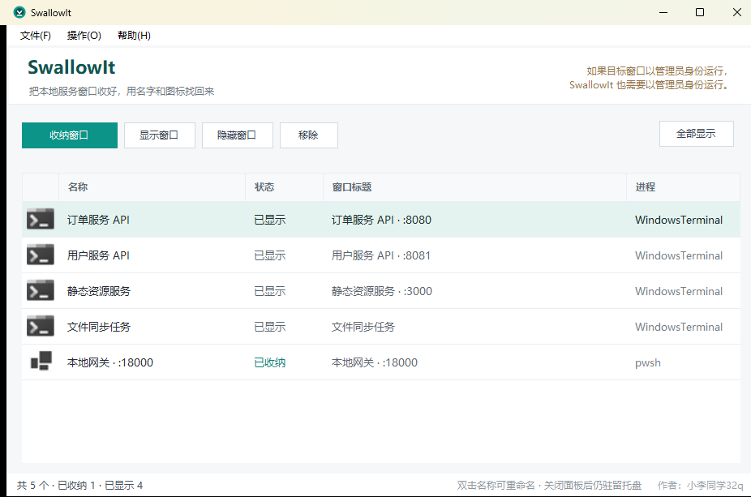
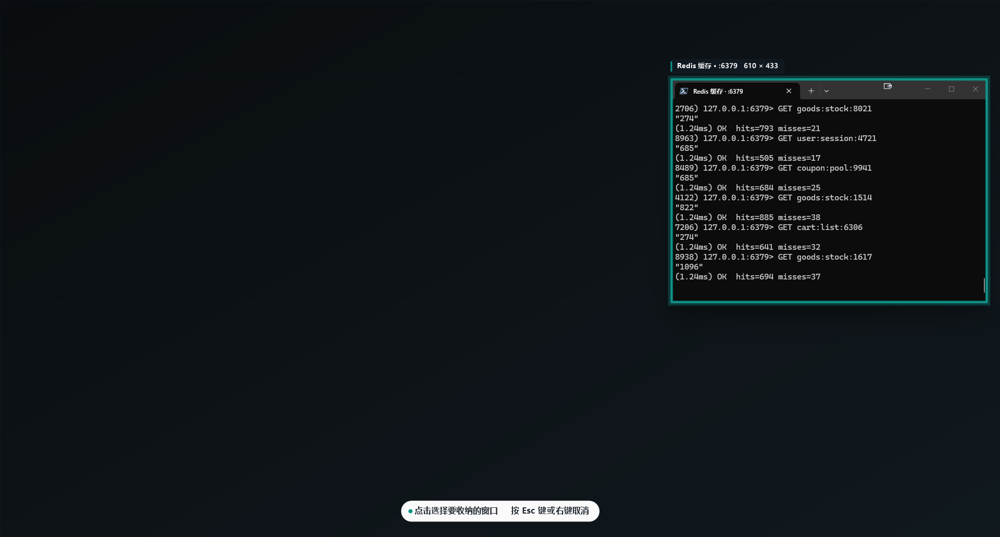
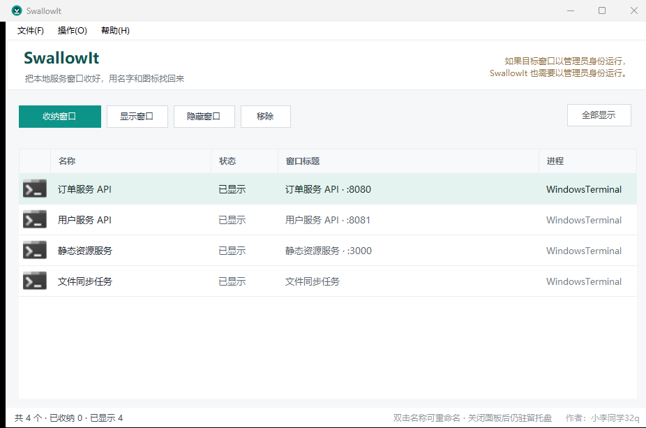

# SwallowIt

> 把本地服务窗口收好，用名字和图标找回来。
> 一个 Windows 托盘小工具：隐藏（不是关闭）那些跑着本地服务的窗口，需要时一键唤回。



作者：小李同学32q · 许可证：[MIT](LICENSE) · 平台：Windows 10 / 11（64 位）

---

## 它解决什么问题

本地开发时，桌面上通常同时开着一堆"不能关、又不想看"的窗口：

- 订单服务、用户服务、Redis、静态资源、文件同步任务……每个都是一个终端窗口；
- 任务栏上全是长得一样的 `>_-` 图标，鼠标点错好几次；
- 用中文/端口命名时，Alt + Tab 里全是 `node`、`pwsh`、`WindowsTerminal`，分不清谁是谁；
- 想让桌面干净一点，只能最小化——然后它们又混进"已最小化"的那一大片里；
- 但**关掉就等于把服务停了**，重启动机、重连数据库、重新登录又要几分钟。

SwallowIt 做的事情很小但很实在：**把这个窗口"吞掉"（`ShowWindow(SW_HIDE)`），在面板里用你起的名字和它的进程图标列出来，点一下就找回来。**

它不启动、不停止、不重启任何服务，也不会结束窗口背后的进程。进程照常运行，端口照常监听，只是窗口暂时看不见。

## 功能

| 功能 | 说明 |
| --- | --- |
| 收纳窗口 | 点击「收纳窗口」，鼠标悬停高亮任意窗口，点一下就收进面板（`Ctrl+N`） |
| 自定义名称 | 收纳后立即可以起一个你自己看得懂的名字，双击列表中的名称即可重命名 |
| 进程图标 | 列表按窗口所属进程显示真实图标，扫一眼就能认出是终端、浏览器还是数据库工具 |
| 一键唤回 | 选中后「显示窗口」，或右键菜单操作；窗口恢复到原来的位置和状态 |
| 行内操作 | 列表每行末尾直接点「显示 / 隐藏」或「移除」，不用先选中再点工具栏 |
| 清理失效记录 | 点「移除已消失」一次清掉所有「窗口已消失」的记录，只删记录、不动窗口 |
| 全部显示 / 全部收纳 | 托盘右键菜单或「操作」菜单里一键处理所有记录 |
| 状态提醒 | 已收纳 / 已显示 / 窗口已消失（进程退出或窗口重建）三种状态实时刷新 |
| 常驻托盘 | 关闭主面板不退出程序，托盘图标右键即可打开面板 |
| 开机自启 | 托盘菜单勾选后以 `--autostart` 静默启动，只驻留托盘不弹面板 |
| 安全退出 | 退出时自动恢复所有被它隐藏的窗口，不会留下"找不回来的窗口" |
| 多显示器 / 高 DPI | 按 PerMonitorV2 适配笔记本 + 外接屏不同缩放比例 |

## 怎么用

1. **下载**：到 [Releases](../../releases) 下载 `SwallowIt-0.1.0-win-x64.zip`，解压到任意目录。
   程序本体只有 1.3 MB，需要 [.NET 10 桌面运行时](https://dotnet.microsoft.com/zh-cn/download/dotnet/10.0)（压缩包内已附带官方安装包，装过就无需再装）。
2. **启动**：双击 `SwallowIt.exe`。首次运行如果 Windows 弹出「已保护你的电脑」，点「更多信息 → 仍要运行」（未签名程序的常规提示）。
3. **收纳**：点「收纳窗口」→ 鼠标移到目标窗口上（会出现高亮和窗口标题+尺寸）→ 点击。窗口立刻消失，出现在列表里。
4. **改名**：新收纳的窗口默认用原标题，双击名称改成"订单服务 API"这种你一眼能认出来的名字。
5. **找回**：在列表里选中，点「显示窗口」；或者右键托盘图标「全部显示」。

点「收纳窗口」后，鼠标悬停的窗口会高亮，并显示它的名称和尺寸，点一下即可收纳：



全部唤回后的样子：



## 从源码构建

需要 .NET 10 SDK（`dotnet --version` ≥ 10.0）。

```bash
# 调试运行
dotnet run --project src/SwallowIt/SwallowIt.csproj

# 发布（框架依赖，产物在 dist/ 下）
dotnet publish src/SwallowIt/SwallowIt.csproj \
  -c Release -r win-x64 --self-contained false \
  -p:PublishSingleFile=false -o dist/SwallowIt-0.1.0-win-x64
```

发布产物只有 `SwallowIt.exe`，把运行库安装包和 `使用说明.txt` 一起打包即为 Release 里的 ZIP。

## 数据与日志

| 位置 | 内容 |
| --- | --- |
| `%AppData%\SwallowIt\entries.json` | 收纳记录（名称、窗口句柄、进程 ID、进程启动时间、原始标题） |
| `%AppData%\SwallowIt\error.log` | 异常日志，程序不会弹窗刷屏，出错都写在这里 |

所有数据都只在本地，程序不联网、不上传任何东西。
卸载：退出程序后删除 `SwallowIt.exe` 和 `%AppData%\SwallowIt` 即可。

## 边界与已知限制

- **只隐藏窗口，不管理进程。** 服务本身该由 pm2 / NSSM / 计划任务管的，还是交给它们；SwallowIt 只负责"让桌面干净"。
- **管理员权限窗口**：如果目标窗口以管理员身份运行，SwallowIt 也需要以管理员身份运行，否则收不进也放不出来（面板上有提示）。
- **窗口句柄会失效**：进程退出、窗口重建（例如终端里 `Ctrl+C` 后重启服务）后，记录会变成"窗口已消失"，此时移除重新收纳即可。
- **不是任务管理器**：无法收纳没有可见顶层窗口的后台进程（服务、托盘程序、部分控制台宿主）。
- **多显示器切换**：窗口会恢复到它原来的位置；把它拖到另一块屏后再收纳，恢复位置以系统记录为准。
- 面板上的「隐藏窗口」和「收纳窗口」是同一件事，只是入口不同。

## License

MIT — 见 [LICENSE](LICENSE)。
